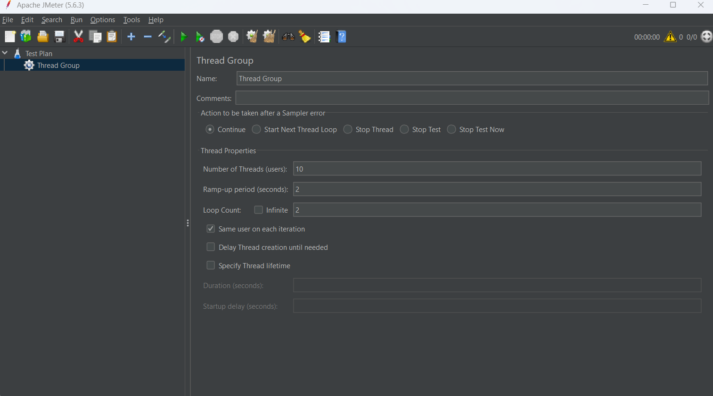
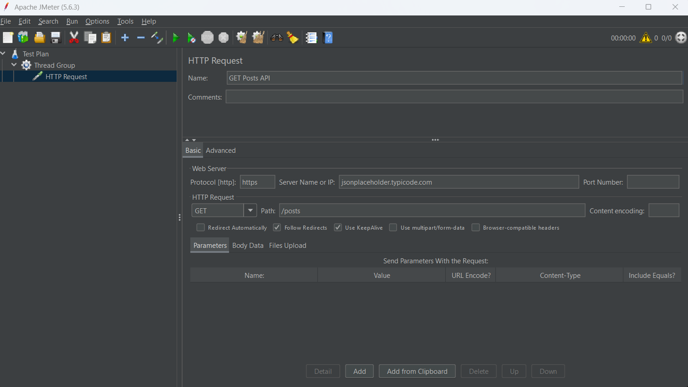
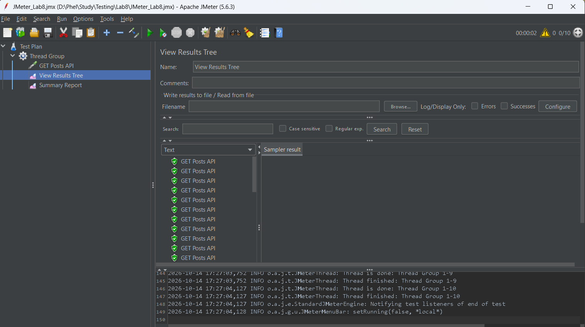
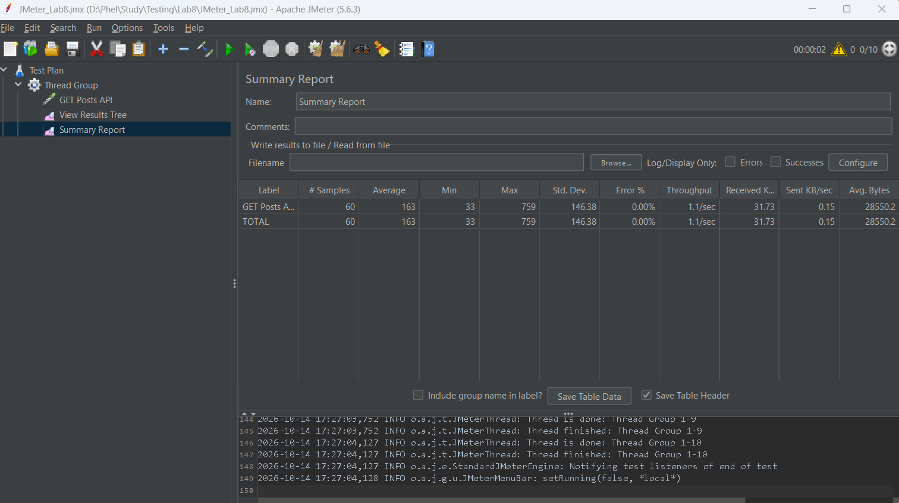

# BÁO CÁO THỰC HÀNH: KIỂM THỬ HIỆU NĂNG VỚI APACHE JMETER

* **Môn học:** Đánh giá & Kiểm thử phần mềm
* **Họ và tên:** Nguyễn Minh Đức
* **MSSV:** 23010171
* **Công cụ sử dụng:** Apache JMeter 5.6.3, JSONPlaceholder API, GitHub

---

## 1. Giới thiệu tổng quan
Bài thực hành hướng dẫn làm quen với kiểm thử hiệu năng (Performance Testing) và tải (Load Testing) bằng công cụ Apache JMeter:
- Cấu hình Test Plan và nhóm người dùng ảo (Thread Group) để mô phỏng tải truy cập đồng thời.
- Thiết lập Sampler HTTP Request gửi phương thức `GET` đến máy chủ REST API.
- Thu thập và phân tích các chỉ số kiểm thử hiệu năng thông qua các Listener: `View Results Tree` và `Summary Report`.

---

## 2. API và Kịch bản kiểm thử
- **Endpoint:** `https://jsonplaceholder.typicode.com/posts`
- **Phương thức:** `GET`
- **Kịch bản tải:**
  - Number of Threads (Users): 10
  - Ramp-up period: 2 giây
  - Loop Count: 6 (Tổng cộng gửi 60 requests)

---

## 3. Các bước thực hiện & Kết quả minh chứng

### 3.1. Cấu hình Thread Group
Mô phỏng 10 người dùng ảo truy cập trong khoảng thời gian 2 giây, lặp lại để tạo tổng cộng 60 mẫu gửi yêu cầu.

---

### 3.2. Cấu hình HTTP Request
Cấu hình chi tiết giao thức `https`, địa chỉ máy chủ `jsonplaceholder.typicode.com`, phương thức `GET` và đường dẫn `/posts`.

---

### 3.3. Kết quả chi tiết từng Request (View Results Tree)
Tất cả các request gửi đi đều phản hồi thành công (mã trạng thái 200 OK) với biểu tượng trạng thái xanh lá cây, không phát sinh lỗi kết nối.

---

### 3.4. Báo cáo thống kê hiệu năng (Summary Report)
Bảng tổng kết hiệu năng sau khi thực thi 60 mẫu:
- **# Samples:** 60
- **Average Response Time:** 163 ms
- **Min / Max:** 33 ms / 759 ms
- **Error %:** 0.00%
- **Throughput:** ~1.1 requests/sec

---

## 4. Kết luận
- Nắm được cách thiết lập và vận hành kịch bản kiểm thử hiệu năng cơ bản với Apache JMeter.
- Biết cách đọc và đánh giá các chỉ số quan trọng như thời gian phản hồi (Response Time), tỷ lệ lỗi (Error %) và thông lượng hệ thống (Throughput).
- Xuất và lưu trữ kịch bản dưới định dạng tệp `.jmx` để phục vụ tái sử dụng hoặc tích hợp kiểm thử tự động.
