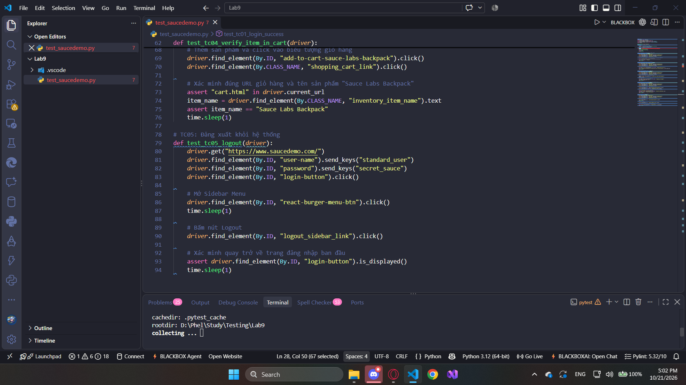
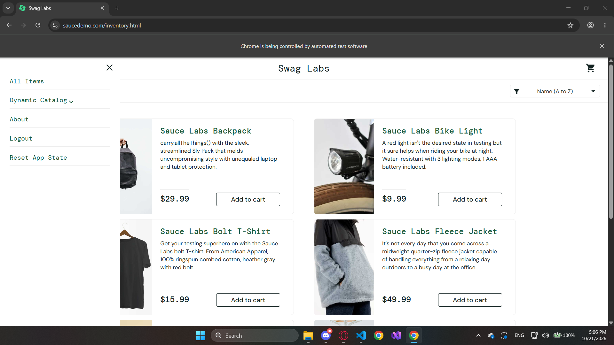
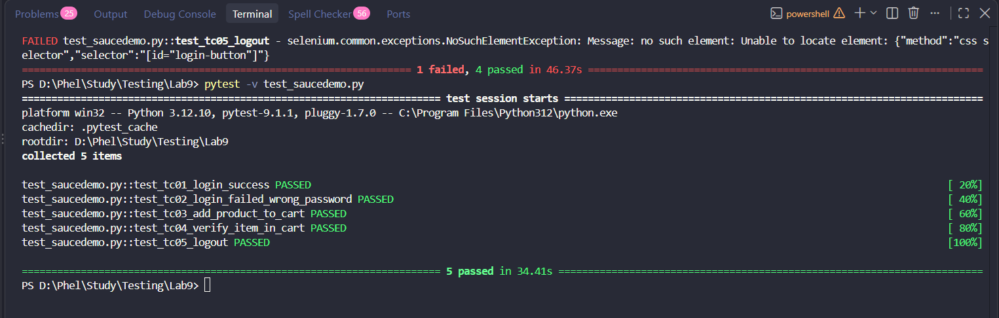

# BÁO CÁO THỰC HÀNH LAB 9: KIỂM THỬ TỰ ĐỘNG GIAO DIỆN VỚI SELENIUM

* **Môn học:** Đánh giá & Kiểm thử phần mềm
* **Họ và tên:** Nguyễn Minh Đức
* **MSSV:** 23010171
* **Công cụ sử dụng:** Python 3.12, Selenium WebDriver, pytest, webdriver-manager, Google Chrome

---

## 1. Giới thiệu tổng quan
Bài thực hành tìm hiểu và ứng dụng công cụ kiểm thử tự động giao diện (UI Automation Testing) với Selenium:
- Thiết lập môi trường tự động hóa với Selenium WebDriver trên nền tảng Python & pytest.
- Áp dụng các kỹ thuật định vị phần tử (Locators: ID, Class Name, CSS Selector).
- Tương tác với giao diện người dùng (nhập liệu, click chuột, xử lý JavaScript click cho animation).
- Sử dụng Assertion để kiểm tra và xác thực kết quả thực tế (Expected vs Actual).

---

## 2. Hệ thống mục tiêu & Kịch bản kiểm thử
- **Website mục tiêu:** SauceDemo (`https://www.saucedemo.com/`)
- **Tài khoản kiểm thử:** `standard_user` / `secret_sauce`

### Danh sách 05 Test Cases:
| Test Case ID | Tên kịch bản | Các bước thực hiện | Kết quả mong đợi |
| :--- | :--- | :--- | :--- |
| **TC01** | Đăng nhập thành công | Nhập đúng Username & Password $\rightarrow$ Bấm Login | Chuyển hướng đến `/inventory.html`, hiển thị tiêu đề "Products" |
| **TC02** | Đăng nhập thất bại | Nhập đúng Username, sai Password $\rightarrow$ Bấm Login | Hiển thị thông báo lỗi `Username and password do not match...` |
| **TC03** | Thêm sản phẩm vào giỏ hàng | Đăng nhập $\rightarrow$ Bấm "Add to cart" sản phẩm Backpack | Icon giỏ hàng cập nhật số lượng badge là `1` |
| **TC04** | Kiểm tra chi tiết giỏ hàng | Thêm sản phẩm $\rightarrow$ Bấm vào biểu tượng giỏ hàng | Chuyển hướng sang `/cart.html`, sản phẩm "Sauce Labs Backpack" có trong danh sách |
| **TC05** | Đăng xuất hệ thống | Mở menu sidebar $\rightarrow$ Bấm nút "Logout" | Đăng xuất thành công, chuyển hướng về trang đăng nhập ban đầu |

---

## 3. Mã nguồn và Minh chứng thực thi

### 3.1. Cấu trúc mã nguồn kiểm thử
Mã nguồn kiểm thử tự động được viết bằng Python kết hợp framework `pytest`.

---

### 3.2. Quá trình thực thi trên trình duyệt
Selenium WebDriver tự động khởi chạy Google Chrome và tương tác trực tiếp trên giao diện trang web.

---

### 3.3. Kết quả kiểm thử trên Terminal
Toàn bộ 05 test cases đều thực thi thành công (`5 passed`), không phát sinh ngoại lệ (Exception) hay lỗi Assertion.

---

## 4. Kết luận
- Nắm vững kiến trúc hoạt động của Selenium WebDriver và cách tích hợp vào quy trình kiểm thử tự động.
- Biết cách xử lý các trường hợp giao diện động (asynchronous / animation overlay) bằng JavaScript Executor (`execute_script`).
- Tự động hóa hoàn toàn luồng người dùng cơ bản từ đăng nhập, duyệt sản phẩm, thao tác giỏ hàng đến đăng xuất.
